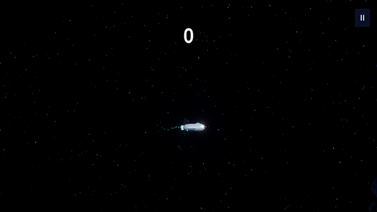

# Beltslip

Arcade space flyer built in **Unity 6 (`6000.0.27f1`, URP, New Input System)**.  
Fly through an endless asteroid belt, collect glowing energy cubes (`+1` cyan in gates, `+2` gold between gates), and dodge oscillating gates and rogue asteroids as speed ramps up.

**[Play in browser on itch.io](https://scr1pt445.itch.io/beltslip)**

## Controls

Hold **`Space`** / **`Left Mouse Button`** / **`Touch`** to thrust up · Release to descend · **`Esc`** or **`||`** to pause.

## Architecture

- **`GameManager`** — game state (`Menu`, `Playing`, `Paused`, `GameOver`), world speed curve, pause/focus handling, and C# events (`OnStateChanged`, `OnScoreChanged`). Zero references to UI or audio.
- **`GameUI` & `GameAudio`** — subscribe to `GameManager` events in `OnEnable` and unsubscribe in `OnDisable` to drive panels, score text, and SFX/engine loop.
- **`ShipController` & `InputHelper`** — vertical thrust physics, pitch/roll tilt, reactive thruster plume, New Input System input with UI pointer guard (`IsPointerOverGameObject()`).
- **`ObstacleSpawner`, `Gate`, `EnergyCore`, `RogueAsteroid`** — `ObjectPool<T>` pooling for gates, asteroids, `+1`/`+2` cubes, and fast rogue asteroids; dedicated `Ship`/`Asteroid` physics layers.
- **`GateSpawnLogic` & `DifficultySettings`** — pure C# spawn math (tested in EditMode) and `ScriptableObject` presets (`Difficulty_Normal`, `Difficulty_Hard`).
- **`HighScore`** — standalone persistence class backed by `IScoreStorage` (`PlayerPrefsScoreStorage`).

## Engineering Highlights

- **Zero-GC obstacle loop:** Replaced runtime `Instantiate`/`Destroy` and `FindObjectsByType` with `UnityEngine.Pool.ObjectPool<T>` and active tracking lists. Verified in Unity Profiler: `0 B` GC Alloc in `Gate.Update` and `0` repeated `AsteroidShape.Awake` allocations after pool warm-up.
- **Event-driven decoupling:** Extracted UI (`GameUI`), audio (`GameAudio`), and save data (`HighScore`) out of `GameManager` so core loop logic stays independent of presentation.
- **Testable pure logic:** Isolated spawn-gap bounds and difficulty interpolation into `GateSpawnLogic` (`Beltslip.Runtime.asmdef`) with 3 passing EditMode unit tests in `BeltslipLogicTests`.
- **WebGL-ready pipeline:** `960x540` viewport, `Gzip` + `Decompression Fallback`, automated build & itch.io ZIP packaging in `Assets/Editor/WebOptimizer.cs`.

## Opening & Running

1. Open the project in **Unity `6000.0.27f1`** (Universal Render Pipeline).
2. Open `Assets/Scenes/Game.unity` and press **Play**.
3. Run EditMode tests via **Window → General → Test Runner** (`BeltslipLogicTests`).
4. Build for itch.io via **Tools → Build WebGL + Pack itch.io ZIP**.

## Audio

All 4 sound effects (`score.wav`, `click.wav`, `explosion.wav`, seamless looping `engine.wav`) are procedurally synthesized `.wav` assets in `Assets/Audio/`.

---

# Beltslip (Русская версия)

Аркадный космический раннер на **Unity 6 (`6000.0.27f1`, URP, New Input System)**.  
Пролетай сквозь астероидный пояс, собирай энерго-кубы (`+1` циановый в воротах, `+2` золотой между воротами) и уклоняйся от осциллирующих ворот и бродячих астероидов при растущей скорости.

**[Играть в браузере на itch.io](https://scr1pt445.itch.io/beltslip)**

## Управление

Удерживай **`Space`** / **`ЛКМ`** / **`Касание`** для тяги вверх · Отпусти для снижения · **`Esc`** или кнопка **`||`** для паузы.

## Как устроен код

- **`GameManager`** — состояния (`Menu`, `Playing`, `Paused`, `GameOver`), скорость мира, пауза и события C# (`OnStateChanged`, `OnScoreChanged`). Не знает про UI и звук.
- **`GameUI` и `GameAudio`** — подписываются на события `GameManager` в `OnEnable`/`OnDisable` и управляют панелями, счётом и звуком.
- **`ShipController` и `InputHelper`** — тяга, наклон модели, динамический шлейф двигателя, опрос New Input System с защитой от нажатий по UI.
- **`ObstacleSpawner`, `Gate`, `EnergyCore`, `RogueAsteroid`** — пулы объектов (`ObjectPool<T>`) для ворот, камней, кубов и бродячих астероидов; отдельные слои физики `Ship` и `Asteroid`.
- **`GateSpawnLogic` и `DifficultySettings`** — чистая математика спавна и `ScriptableObject`-пресеты сложности (`Difficulty_Normal`, `Difficulty_Hard`).
- **`HighScore`** — отдельный класс сохранения рекорда через интерфейс `IScoreStorage`.

## Что сделано и зачем

- **Пул объектов и слои физики:** убраны `Instantiate`/`Destroy` во время игры и `FindObjectsByType`. По замерам Unity Profiler: `0 B` GC Alloc в `Gate.Update` и `0` повторных `AsteroidShape.Awake` после прогрева пула.
- **Разделение ответственности:** UI, аудио и сохранение рекорда вынесены из `GameManager` через события и интерфейсы.
- **Юнит-тесты логики:** расчёт границ прохода вынесен в `GateSpawnLogic` (`Beltslip.Runtime.asmdef`), покрыт 3 EditMode-тестами (`BeltslipLogicTests`).
- **Сборка под WebGL:** `960x540`, `Gzip` + `Decompression Fallback`, автосборка и упаковка ZIP в `Assets/Editor/WebOptimizer.cs`.

## Запуск проекта

1. Открыть проект в **Unity `6000.0.27f1`**.
2. Открыть сцену `Assets/Scenes/Game.unity` и нажать **Play**.
3. Тесты: **Window → General → Test Runner** (режим EditMode, `BeltslipLogicTests`).
4. Сборка для itch.io: **Tools → Build WebGL + Pack itch.io ZIP**.

## Звуки

Все 4 звуковых эффекта (`score.wav`, `click.wav`, `explosion.wav`, зацикленный `engine.wav`) сгенерированы процедурно в `Assets/Audio/`.
